<!-- readme-standard: 2026-11-02 -->
<div align="center">



# Psychedelic Policy Reform · dApp preview

*The interactive side of an RFRA-based psychedelic policy reform initiative, seen from Pennsylvania: the evidence library's shelves, a pledge you can try with a wallet signature, and updates.*


[](https://github.com/drasticstatic/psychedelic-policy-reform-dapp-public-preview/blob/main/LICENSE)
[](https://github.com/drasticstatic/psychedelic-policy-reform-dapp-public-preview/blob/main/LICENSE-CONTENT)
[](https://drasticstatic.github.io/psychedelic-policy-reform-dapp-public-preview/)
[](https://drasticstatic.github.io/psychedelic-policy-reform-astro-public/)
[](https://code.claude.com/docs/en/overview)

 **You are here:** drasticstatic lab › `psychedelic-policy-reform-dapp` · private source · `main` is the working branch · public twin `psychedelic-policy-reform-dapp-public-preview`

</div>

##  TL;DR

1.  **What this is.** The source of the dApp preview: a Next.js static export. The pledge is a preview and records nothing.
2.  **Who it is for.** Visitors who want to try the interactive side of the initiative.
3.  **Do this first.** [Open the preview](https://drasticstatic.github.io/psychedelic-policy-reform-dapp-public-preview/).

**🧪 [Open the preview →](https://drasticstatic.github.io/psychedelic-policy-reform-dapp-public-preview/)** ·
**📜 [The AstroLog →](https://drasticstatic.github.io/psychedelic-policy-reform-astro-public/)** (the initiative's open record)

---

## 👋 What this is

A Next.js preview of the initiative's interactive side:

- **Evidence**: the evidence library's shelves (law and statutes, court decisions, research, religious
  practice, policy across the states, Pennsylvania), each "coming soon" until its sources are reviewed.
- **Pledge**: a *preview* of signing a short pledge of support with a wallet signature. No gas, no
  contract, no transaction; the signature is checked in the browser tab and forgotten. **Nothing is
  recorded yet**, and no wallet address or signature is ever shown or stored.
- **Updates**: the newest entries from the AstroLog.
- **About** and **Map**.

> **Not legal advice.** Everything here is general information, written for understanding.

**Partner organizations:** to be announced.

## 🌗 One suite with the AstroLog

The preview loads the **arrival kit** (v1.5.1, English first with Español one tap away) from the AstroLog by absolute URL
(`https://drasticstatic.github.io/psychedelic-policy-reform-astro-public/arrival/`): the one-row navbar
with its More and Menu folds, the contact and community windows, reading mode, what's new, `/` search
and the welcome guide. Light and motion choices carry between the two sites. Every page's share card
is drawn by the AstroLog's build.

## 👛 Wallet connect

Reown AppKit (with the wagmi adapter): one button for browser wallets, phone wallets by QR code and
email sign-in. It needs `NEXT_PUBLIC_REOWN_PROJECT_ID` (a repository secret the deploy workflow passes
in), and the Reown project's allowlist must include `https://drasticstatic.github.io`. Without an ID,
AppKit isn't started: the pledge offers a browser wallet if one is installed and says what's missing.
There is no fallback or demo ID.

| Variable | Purpose |
| --- | --- |
| `NEXT_PUBLIC_REOWN_PROJECT_ID` | Reown project ID (cloud.reown.com). Unset = graceful browser-wallet fallback |
| `NEXT_PUBLIC_BASE_PATH` | `/psychedelic-policy-reform-dapp-public-preview`, set by the deploy workflow |

## 🔒 Private / public split

This repository is private. [`deploy-pages.yml`](.github/workflows/deploy-pages.yml) builds the static
export and pushes it to the `gh-pages` branch of
[`psychedelic-policy-reform-dapp-public-preview`](https://github.com/drasticstatic/psychedelic-policy-reform-dapp-public-preview);
[`sync-public-allowlist.yml`](.github/workflows/sync-public-allowlist.yml) mirrors only the allowlisted
source to its `main`. Agent files, `.githooks/` and `scripts/` stay private. Both need the
`PUBLIC_REPO_TOKEN` secret; until it exists they build, then skip the publish with a warning.

## 💻 Local development

```sh
sh scripts/install-hooks.sh   # once per clone
npm install
npm run dev     # Next.js dev server (webpack)
npm run build   # static export to out/
```

Requires Node.js `>=22.12.0`. The kit and share cards load from the live AstroLog.

## 📄 License

- 💻 **Code:** MIT, see [`LICENSE`](https://github.com/drasticstatic/psychedelic-policy-reform-dapp-public-preview/blob/main/LICENSE)
- 📝 **Written content:** CC BY-SA 4.0, see [`LICENSE-CONTENT`](https://github.com/drasticstatic/psychedelic-policy-reform-dapp-public-preview/blob/main/LICENSE-CONTENT)
- 🏷️ **Names and marks:** see [`TRADEMARKS.md`](https://github.com/drasticstatic/psychedelic-policy-reform-dapp-public-preview/blob/main/TRADEMARKS.md)

---

*Kept by Christopher W ([drasticstatic](https://github.com/drasticstatic)) with Alfred, using Anthropic's Claude Code CLI.*

##  Suggest a change

Noticed something? Open an [issue](../../issues) or a pull request against `main`; Christopher reads them and a person with the role merges. Not on GitHub? Reach Christopher through [his contact page](https://drasticstatic.github.io/resume/pages/contact.html).

<sub>The front door follows the living [README standard](https://github.com/drasticstatic/my-template/blob/main/README-STANDARD.md). Copy it, improve it.</sub>
